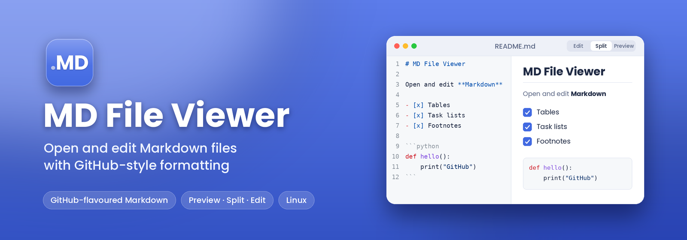

<!--
MD File Viewer
Author:     Amiran Kimadze (itsarmen)
GitHub:     https://github.com/itsarmen
Email:      amoswaper@gmail.com
Web:        https://xrow.asia
-->

<p align="center">
  
</p>

<p align="center">
  <a href="https://flutter.dev"></a>
  <a href="https://dart.dev"></a>
  
  
  
  <a href="https://github.com/itsarmen/MD-File-Viewer-Software/blob/main/LICENSE"></a>
</p>

<p align="center">
  A native Linux desktop app to <strong>view and edit Markdown</strong> files with
  <strong>GitHub-style formatting</strong>, built with Flutter and the Yaru (GNOME) theme.
</p>

---

## Features

- **GitHub-flavored preview** — headings, tables, task lists, blockquotes, fenced code
  blocks with syntax highlighting, and images rendered the way GitHub shows them.
- **Three view modes** — `Preview`, `Split` (editor + preview side by side), and `Edit`.
- **Fast editing** — monospaced editor with live dirty-state tracking and `Ctrl+S` saving.
- **Folder browsing** — open a whole folder and switch between its Markdown files from the sidebar.
- **Recent files** — remembers your recent documents and last opened folder between sessions.
- **Selectable text** — the entire UI is a `SelectionArea`, so any text can be selected and
  copied, with a native right-click context menu.
- **Smart links** — left-click a link to open it; external links open in your default browser,
  while links to local Markdown files open right inside the app.
- **Link right-click menu** — *Open link in browser*, *Copy link address*, and *Copy link text*.
- **Copy button on code blocks** — one click to copy a fenced code block to the clipboard.
- **Default `.md` handler** — opt in from *Quick Settings* to make double-clicking a Markdown
  file open this app.
- **GNOME / Nautilus integration** — adds an *“Open in MD File Viewer”* right-click entry.
- **Native look & feel** — Yaru theme with automatic light/dark following the system.
- **Keyboard scrolling** — arrows, Page Up/Down and Home/End scroll the preview instantly.

## Screenshots

> Add screenshots here (e.g. `docs/preview.png`, `docs/split.png`) to showcase the app.

## Requirements

- Linux (developed on GNOME / Wayland; works on X11 too)
- [Flutter](https://docs.flutter.dev/get-started/install/linux) 3.x with Linux desktop support
- A C++ toolchain and GTK 3 development headers (`clang`, `cmake`, `ninja-build`,
  `pkg-config`, `libgtk-3-dev`) — see Flutter’s Linux setup guide.

## Build from source

```bash
git clone https://github.com/itsarmen/MD-File-Viewer-Software.git
cd MD-File-Viewer-Software

flutter pub get
flutter build linux --release
```

The release bundle is produced under `build/linux/x64/release/bundle/`.

## Install

A helper script installs the binary, icons and desktop entry into `~/.local` for the
current user, then registers the app as a Markdown handler:

```bash
./scripts/install.sh
```

It will:

- copy the release bundle to `~/.local/share/md-file-viewer/`;
- install a launcher at `~/.local/bin/md-file-viewer`;
- install icons for every standard size (`16`–`512`) plus a scalable SVG;
- install `~/.local/share/applications/md-file-viewer.desktop`;
- add a **Nautilus “Scripts”** entry to open selected files;
- refresh the desktop database and icon cache.

Set `PREFIX=...` to install somewhere else, e.g. `PREFIX=/usr/local ./scripts/install.sh`.

After installing, launch it from your applications list, or:

```bash
md-file-viewer path/to/README.md
```

## Build a Debian package (.deb)

To build a distributable Debian/Ubuntu package (requires the release bundle and `dpkg-deb`):

```bash
flutter build linux --release
./scripts/build-deb.sh
```

This produces `dist/md-file-viewer_<version>_<arch>.deb`, containing the app bundle under
`/usr/lib/md-file-viewer/`, a launcher at `/usr/bin/md-file-viewer`, icons, the desktop entry
and documentation. The version is read from `pubspec.yaml` and the architecture from the host.

Install it with:

```bash
sudo dpkg -i dist/md-file-viewer_*.deb
# or, to pull in any missing dependencies automatically:
sudo apt install ./dist/md-file-viewer_*.deb
```

Options: `--version X.Y.Z` to override the version, `--arch amd64` to target another
architecture.

## Usage

### Opening files

- **Open file** (`Ctrl+O`, or the toolbar button) — pick a `.md` file.
- **Open folder** — load a directory and navigate its Markdown files from the sidebar.
- Launching from the terminal with a path opens that file directly.

Supported extensions: `md`, `markdown`, `mdx`, `mdown`, `mkd`, `txt`.

### View modes

Use the segmented control in the toolbar to switch between:

| Mode | Description |
| --- | --- |
| **Preview** | Rendered GitHub-style view. |
| **Split** | Editor on the left, live preview on the right. |
| **Edit** | Raw Markdown editor only. |

### Keyboard shortcuts

| Shortcut | Action |
| --- | --- |
| `Ctrl+O` | Open file |
| `Ctrl+S` | Save |
| `Ctrl+Shift+S` | Save as… |
| `↑` / `↓` | Scroll preview by one line |
| `Page Up` / `Page Down` | Scroll preview by one page |
| `Home` / `End` | Jump to top / bottom of preview |

### Links

- **Left-click** a link: external URLs open in your browser; local `.md` links open in the app.
- **Right-click** a link: *Open link in browser*, *Copy link address*, *Copy link text*.
- **Select text** anywhere and use the native context menu to copy it.

### Desktop integration

Open **Quick Settings** (gear icon) to see whether the app is installed and whether it is the
default Markdown handler, and to set it as the default with one click.

## Project structure

```
lib/
  main.dart                     # entry point
  src/
    app.dart                    # MaterialApp + YaruTheme
    home_page.dart              # main UI: sidebar, editor, preview, status bar
    github_markdown.dart        # GitHub-flavored Markdown renderer
    settings_dialog.dart        # Quick Settings dialog
    desktop_integration.dart    # xdg-mime default-handler helpers
    recent_store.dart           # recent files / last folder persistence
    toast.dart                  # centered transient messages
data/
  md-file-viewer.desktop        # desktop entry
icons/                          # app icons + README banner
scripts/
  install.sh                    # user-level installer
  build-deb.sh                  # Debian (.deb) package builder
test/                           # widget & scroll tests
```

## Built with

- [Flutter](https://flutter.dev) & [Yaru](https://pub.dev/packages/yaru) — UI and GNOME theming
- [`flutter_markdown`](https://pub.dev/packages/flutter_markdown) & [`markdown`](https://pub.dev/packages/markdown) — rendering
- [`flutter_highlight`](https://pub.dev/packages/flutter_highlight) / [`highlight`](https://pub.dev/packages/highlight) — code syntax highlighting
- [`file_picker`](https://pub.dev/packages/file_picker) — native file & folder dialogs
- [`url_launcher`](https://pub.dev/packages/url_launcher) — link handling

## Author

**Amiran Kimadze** (*itsarmen*)

- GitHub: [@itsarmen](https://github.com/itsarmen)
- Email: [amoswaper@gmail.com](mailto:amoswaper@gmail.com)
- Web: [https://xrow.asia](https://xrow.asia)

## License

MD File Viewer is **free and open-source software** released under the
[MIT License](LICENSE). Anyone is welcome to use, study, modify, and improve it —
forks and contributions are encouraged. The original author and copyright holder is
**Amiran Kimadze (itsarmen)**, who must remain credited in all copies and derivative
works. See [LICENSE](LICENSE) for the full text.
